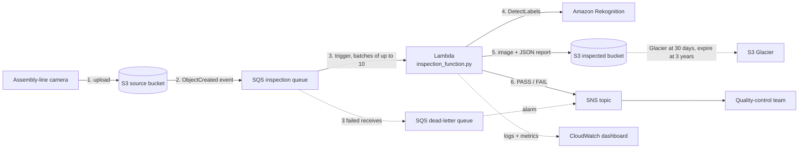
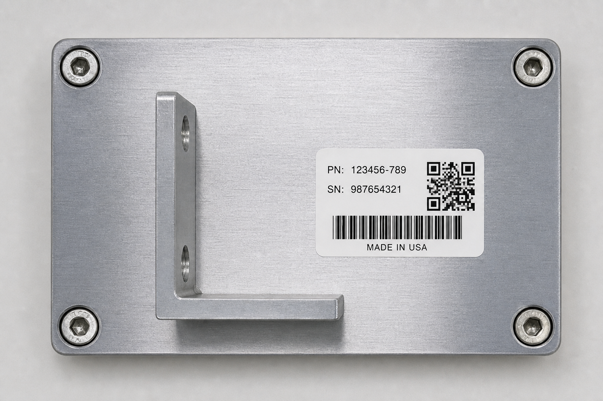
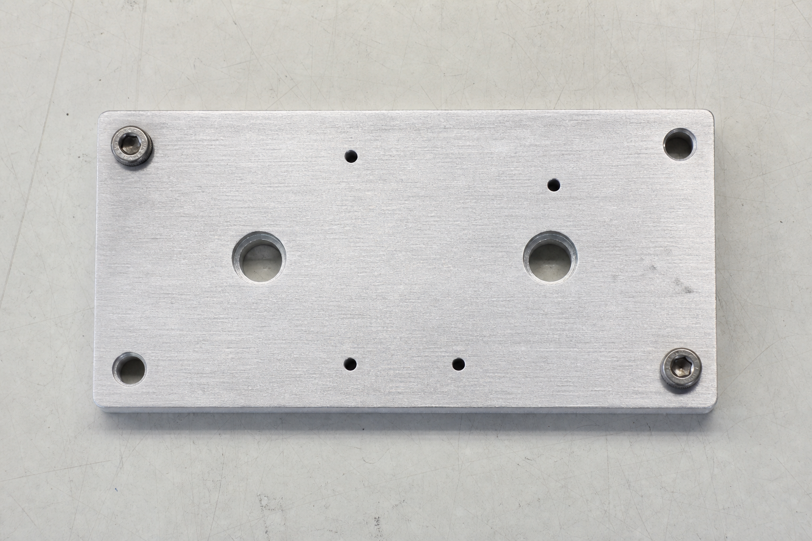

# InspectFlowAI

[](https://github.com/mahekkhan6976/InspectFlowAI/actions/workflows/ci.yml)
[](lambda/inspection_function.py)
[](template.yaml)
[](LICENSE)

**Serverless, event-driven visual quality inspection on AWS.** A camera on an
assembly line drops a photo of a part into S3. Within seconds the pipeline runs
Amazon Rekognition on it, decides **PASS / FAIL** against a configurable rule,
archives the image plus a JSON report under a 3-year retention policy, and
notifies the quality-control team. No servers, effectively $0 at idle, deployed
with one command.

```
S3 upload → SQS (+ dead-letter queue) → Lambda → Rekognition → S3 archive (Glacier) + SNS
```

**Stack:** Python 3.12 · AWS Lambda · S3 · SQS · Amazon Rekognition · SNS ·
CloudWatch · S3 Glacier · AWS SAM / CloudFormation · GitHub Actions

## The problem

A manufacturer inspected parts by hand: a worker photographs each widget, an
inspector checks that every required component is present, the result is
emailed to Quality Control, and the photo is filed for three years of
compliance. Every one of those steps is now automatic:

| Requirement | Implementation |
|---|---|
| Fully automated, starting from the image | S3 `ObjectCreated` event drives the whole flow |
| Serverless, decoupled, resilient | S3, SQS + dead-letter queue, Lambda, Rekognition, SNS, Glacier |
| Image-recognition inspection | Rekognition `DetectLabels` compared with a configurable list of required components |
| Notify Quality Control | SNS message with the verdict, the missing components, and the report location |
| Archive image + results | Copied to `inspected/pass/` or `inspected/fail/` next to a JSON report |
| 3-year compliance retention | S3 lifecycle rule: Glacier after 30 days, expire after 1095 days |
| Monitoring for support | CloudWatch dashboard, dead-letter-queue alarm, structured logs |
| Security | SQS policy restricted to the S3 service and this bucket; least-privilege IAM policy |
| QA before production | 11 offline unit tests (AWS mocked), `cfn-lint`, `shellcheck`, CI on every push |

## Architecture



**How one inspection runs** ([`lambda/inspection_function.py`](lambda/inspection_function.py)):

1. SQS invokes the Lambda with a batch of S3 event records. S3 "test events"
   that carry no records are recognised and skipped.
2. The object key is URL-decoded and sent to Rekognition `DetectLabels` with
   the configured minimum confidence.
3. Detected label names are compared with `EXPECTED_LABELS`. Each required
   component may list synonyms (`hardware|machine|motor`); a component is
   satisfied if any synonym is detected. Any unsatisfied component means
   **FAIL**, and the report names exactly which ones.
4. The original image is copied to the inspected bucket under
   `inspected/pass/` or `inspected/fail/`, next to `<image>.report.json`
   containing the verdict, every detected label with its confidence, and the
   missing components.
5. An SNS message with the verdict and the report location goes to the
   quality-control topic.
6. Any exception is logged and re-raised so SQS retries. After three failed
   attempts the message lands in the dead-letter queue and a CloudWatch alarm
   notifies the same topic.

## Design decisions

- **A queue between S3 and Lambda, not a direct trigger.** SQS buffers bursts
  from the line, allows batching, and provides a dead-letter queue with a
  retry policy. A direct S3→Lambda trigger has no DLQ for the source event and
  less control over retries.
- **The inspection rule is configuration, not code.** `EXPECTED_LABELS` and
  `MIN_CONFIDENCE` are Lambda environment variables, so retuning the rule for
  a new part is a config change with no redeploy. Synonym groups were added
  after testing showed Rekognition labels a motor assembly `Machine` or
  `Motor` rather than `Hardware`.
- **Fail loudly, recover automatically.** The boto3 clients have explicit
  connect/read timeouts and standard-mode retries; the handler re-raises on
  failure so the SQS redrive policy, not application code, owns retry and
  dead-lettering. The DLQ depth is alarmed.
- **Results are self-describing.** Each archived image sits next to a JSON
  report with every detected label and confidence, so a FAIL can be audited
  three years later without re-running anything.
- **Retention is enforced by the platform.** An S3 lifecycle rule on
  `inspected/` moves objects to Glacier after 30 days and expires them at
  1095 days; no code has to remember to clean up.
- **Least privilege, documented even where the lab prevents it.** The AWS
  Academy Learner Lab blocks IAM role creation, so the stack attaches the lab's
  existing role. [`infrastructure/lambda-execution-policy.json`](infrastructure/lambda-execution-policy.json)
  records the exact least-privilege policy a production account would use, and
  the SQS policy only lets the S3 service, from this one bucket, enqueue
  messages.
- **Everything is reproducible.** One CloudFormation/SAM template creates every
  resource, including the dashboard and alarm. `deploy.sh` is idempotent and
  derives bucket names from the account ID, so two people can deploy side by
  side without name collisions.

## Results

Twelve labelled images covering every combination of the inspected components
were run through the deployed pipeline. All twelve received the intended
verdict (5 PASS / 7 FAIL):

| Scenario | Images | Outcome |
|---|---|---|
| Compliant part: hardware + QR label | 4 | **PASS** |
| Motor gearbox labelled `Machine`/`Motor`, with QR | 1 | **PASS** via synonym group |
| Hardware only, no label | 2 | FAIL, missing `qr code` |
| Hardware with a text label but no QR | 1 | FAIL |
| QR sticker only, or label only, no hardware | 2 | FAIL, missing hardware |
| Non-widget controls (apple, volleyball) | 2 | FAIL |

Per-image Rekognition output is in [`dataset/README.md`](dataset/README.md);
a captured end-to-end run with log traces is in
[`docs/DEMO_RESULTS.md`](docs/DEMO_RESULTS.md).

<p align="center">
  
  &nbsp;
  
</p>

## Repository layout

```
lambda/inspection_function.py   The Lambda handler (the core of the project)
template.yaml                   SAM/CloudFormation: every resource, the dashboard, the alarm
run.sh                          One command: deploy, inspect the whole dataset, print the matrix
scripts/deploy.sh               Idempotent deploy with the AWS CLI alone (no SAM CLI needed)
scripts/demo.sh                 Upload one image, tail the Lambda logs, list the artifacts
scripts/detect.sh               Print what Rekognition sees in an image (to tune the rule)
scripts/check.sh                Pre-flight check: tooling, credentials, stack, SNS subscription
scripts/teardown.sh             Empty the buckets and delete the stack
tests/test_inspection.py        11 unit tests with AWS mocked (no account needed)
tests/local_invoke.py           Run the handler locally against real AWS
infrastructure/                 Least-privilege IAM policy, SQS access policy, lifecycle rule
dataset/                        12 labelled images across 7 scenarios, plus the results matrix
docs/DEMO_RESULTS.md            Captured live run with log traces
docs/MANUAL_SETUP.md            Building the same pipeline by hand in the AWS console
docs/presentation/              Slide deck and speaker notes from the course presentation
.github/workflows/ci.yml        CI: unit tests, cfn-lint, shellcheck
```

## Quick start

### Prerequisites

- Python 3.12+ and the AWS CLI v2.
- AWS credentials exported in your shell. The project was built in the AWS
  Academy Learner Lab and defaults to its `LabRole`; in a regular account set
  `LAB_ROLE_ARN` to any Lambda execution role that has the permissions in
  [`infrastructure/lambda-execution-policy.json`](infrastructure/lambda-execution-policy.json).

### Run the tests (no AWS account needed)

```bash
pip install -r requirements-dev.txt
make test     # 11 unit tests, AWS mocked
make lint     # cfn-lint on the template, shellcheck on the scripts
```

### Deploy, inspect the whole dataset, see the results

```bash
./run.sh
```

`run.sh` verifies credentials, deploys the stack (idempotent, safe to re-run),
waits for the SQS trigger to come up, uploads all 12 dataset images, and prints
the PASS/FAIL matrix read back from the live JSON reports. Add
`QC_EMAIL=you@example.com` to receive the SNS notifications (confirm the
subscription email first).

### Inspect a single image

```bash
./scripts/demo.sh dataset/01-compliant/compliant-pcb.png   # PASS
./scripts/demo.sh dataset/06-non-widget/volleyball.png      # FAIL
```

The script uploads the image, tails the Lambda's CloudWatch logs so the verdict
shows up live, and lists the archived artifacts.

### Tear down

```bash
ACCT=$(aws sts get-caller-identity --query Account --output text)
DEPLOY_BUCKET="inspectflow-deploy-$ACCT-us-east-1" \
SOURCE_BUCKET="inspectflow-source-$ACCT" \
INSPECTED_BUCKET="inspectflow-inspected-$ACCT" \
./scripts/teardown.sh
```

Prefer the console? [`docs/MANUAL_SETUP.md`](docs/MANUAL_SETUP.md) builds the
same pipeline step by step by hand.

## Configuration

All tuning is done through Lambda environment variables, set by the template
and editable in the console without a redeploy:

| Variable | Example | Purpose |
|---|---|---|
| `EXPECTED_LABELS` | `hardware\|machine\|motor,qr code` | Required components, comma-separated; `\|` lists synonyms within one component |
| `MIN_CONFIDENCE` | `80` | Minimum Rekognition confidence (%) for a label to count |
| `MAX_LABELS` | `20` | Maximum number of labels requested from Rekognition |
| `INSPECTED_BUCKET` | `inspectflow-inspected-<account>` | Archive bucket |
| `INSPECTED_PREFIX` | `inspected` | Key prefix inside the archive bucket |
| `SNS_TOPIC_ARN` | `arn:aws:sns:us-east-1:<account>:inspectflow-quality-control` | Quality-control topic |

To pick labels for a new part, run `./scripts/detect.sh path/to/photo.jpg 80`
and choose labels that appear on a compliant part but not on a defective one.

## Monitoring and operations

- **CloudWatch dashboard `InspectFlowAI`**: Lambda invocations, errors and
  duration; inspection-queue depth; dead-letter-queue depth.
- **Alarm `inspectflow-dlq-not-empty`**: notifies the quality-control topic
  when any message reaches the DLQ, i.e. after three failed inspection
  attempts.
- **Logs**: every invocation logs the bucket/key, verdict, archive location and
  notification status under `/aws/lambda/inspectflow-inspection`.
- **Cost**: pay-per-use only (no EC2, NAT or load balancers); the stack idles
  at effectively $0.

## Testing and CI

- [`tests/test_inspection.py`](tests/test_inspection.py): 11 unit tests that
  swap the boto3 clients for mocks and cover the PASS and FAIL paths, synonym
  groups, case-insensitive matching, URL-encoded keys, S3 test events,
  multi-record batches, the JSON report contract, and failure propagation to
  the DLQ.
- `cfn-lint` validates the template; `shellcheck` validates the scripts.
- GitHub Actions runs all of the above on every push and pull request.
- [`tests/local_invoke.py`](tests/local_invoke.py) runs the real handler
  against real AWS services for an integration check before go-live.

## Limitations and next steps

- **Generic vision model.** Rekognition `DetectLabels` has a fixed vocabulary.
  It reliably tells a labelled part from an unlabelled one, but it cannot spot
  a single missing screw. The production path is Rekognition Custom Labels
  trained on real photos of the part.
- **Whole-batch retry.** One failing record fails the whole SQS batch (up to
  10), so healthy records in that batch are reprocessed. SQS partial batch
  responses (`ReportBatchItemFailures`) would isolate the bad record.
- **At-least-once delivery.** A redelivered message re-runs the inspection.
  Archive keys are deterministic, so the report is simply overwritten, but the
  notification would be sent twice. An idempotency key in DynamoDB would close
  that gap.
- **Label contents are not read.** `DetectLabels` reports that a label or QR
  code exists; verifying what it says would need `DetectText` or a QR decoder.
- **Lab constraints.** The Learner Lab forbids creating IAM roles, so the
  deployed stack uses the shared `LabRole` rather than the least-privilege
  policy documented in `infrastructure/`.

## Background

Course project for ITC6450 at Northeastern University, built and demonstrated
live in the AWS Academy Learner Lab. The slide deck and speaker notes from the
presentation are in [`docs/presentation/`](docs/presentation/).
