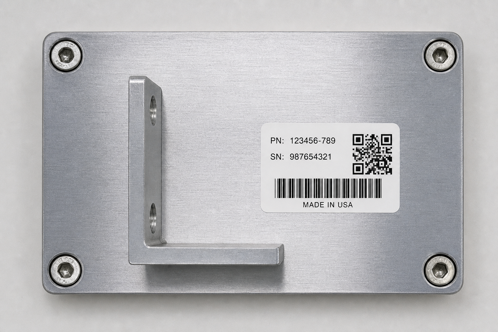
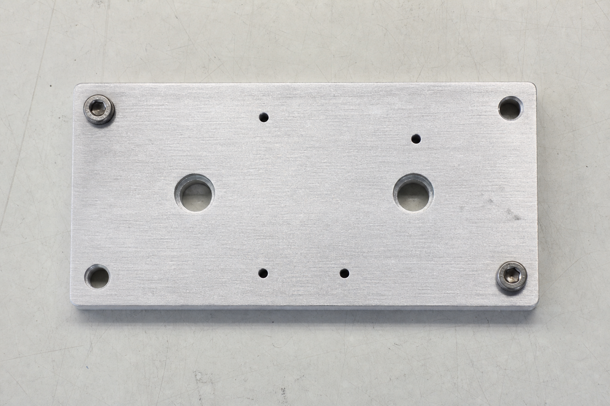

# InspectFlowAI — Captured live run

Captured from a real run against the deployed stack in `us-east-1`, kept as
evidence of the end-to-end flow (and as a backup for live demos).

Configuration at the time of this capture:
- `EXPECTED_LABELS = hardware,qr code,text`
- `MIN_CONFIDENCE = 75`

The rule was later tightened to `hardware|machine|motor,qr code` at 80%
confidence: synonym groups were added (Rekognition labels a motor assembly
`Machine`/`Motor`, not `Hardware`) and `text` was dropped because `DetectLabels`
only emits it for large, prominent text. See `dataset/README.md` for the final
12-image matrix (5 PASS / 7 FAIL) run with that rule.

## Case 1 — Compliant widget → PASS



Rekognition detected `Hardware` (99.99%), `QR Code` (91.56%), `Text` (80.16%),
plus Electronics / Computer / Business Card / Paper.

```json
{
  "source_key": "demo-good-030239.png",
  "inspection_status": "PASS",
  "expected_labels": ["hardware", "qr code", "text"],
  "missing_labels": [],
  "min_confidence": 75.0
}
```

Archived to `s3://inspectflow-inspected-<ACCOUNT_ID>/inspected/pass/`.

## Case 2 — Non-compliant widget → FAIL



Missing the bracket, the label, and most screws. Rekognition detected only

`Aluminium`, `Mailbox`, `Ball/Volleyball` — none of the required components.

```json
{
  "source_key": "demo-bad-030239.png",
  "inspection_status": "FAIL",
  "expected_labels": ["hardware", "qr code", "text"],
  "missing_labels": ["hardware", "qr code", "text"],
  "min_confidence": 75.0
}
```

Archived to `s3://inspectflow-inspected-<ACCOUNT_ID>/inspected/fail/`.

## CloudWatch log trace (both cases)

```
[INFO] Inspection result for demo-good-030239.png: PASS
[INFO] Archived image -> s3://.../inspected/pass/demo-good-030239.png
[INFO] Published SNS notification (PASS) for demo-good-030239.png
[INFO] Inspection result for demo-bad-030239.png: FAIL
[INFO] Archived image -> s3://.../inspected/fail/demo-bad-030239.png
[INFO] Published SNS notification (FAIL) for demo-bad-030239.png
```

This proves the full event flow end to end: S3 upload → SQS → Lambda →
Rekognition → pass/fail archive → SNS notification, with CloudWatch monitoring.
